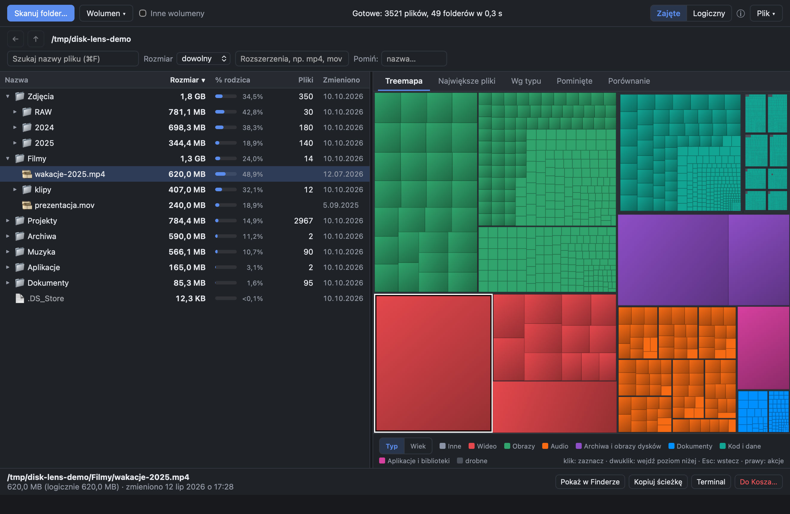
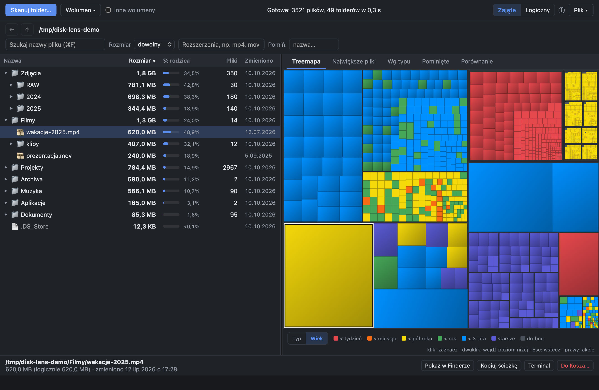
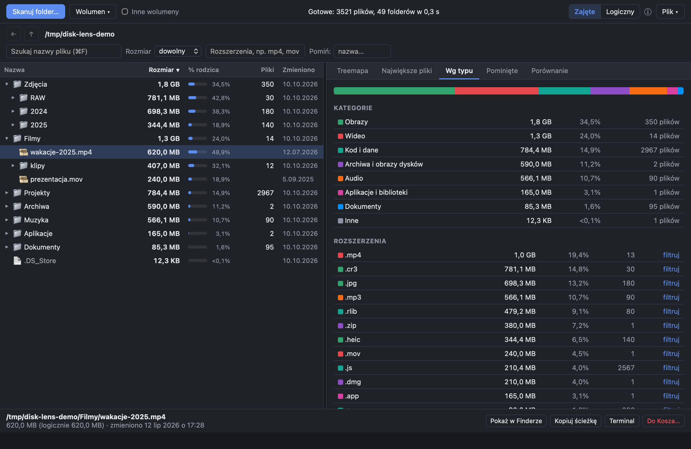

# Disk Lens



Analizator zajętości dysku dla macOS, Windows i Linuxa w stylu GrandPerspective / WinDirStat. Pokazuje te same dane na dwa sposoby:

- **treemapa**: każdy plik to prostokąt o polu proporcjonalnym do rozmiaru (algorytm squarified, Canvas);
- **drzewo folderów**: sumy, procent rodzica, liczba plików i folderów, sortowanie po każdej kolumnie.

Do tego dochodzą:
- zakładki: największe pliki, podział wg typu, pominięte ścieżki, porównanie dwóch skanów, dysk (pojemność, wolne miejsce, zestawienie skanu z zajętością dysku);
- filtry: nazwa, minimalny rozmiar, rozszerzenia, wykluczenia; działają bez ponownego skanu;
- akcje: pokaż w menedżerze plików (Finder / Eksplorator), kopiowanie ścieżki, terminal, ponowny skan folderu, przeniesienie do Kosza;
- eksport do CSV/JSON oraz zapis i odczyt skanu w pliku `.disklens`.

## Instalacja

Pobierz paczkę dla swojego systemu z [Releases](../../releases):

| System | Plik |
|---|---|
| macOS 11+ (Apple Silicon i Intel) | `Disk.Lens_<wersja>_universal.dmg` |
| Windows 10/11 x64 | `Disk.Lens_<wersja>_x64-setup.exe` |
| Windows 11 ARM64 | `Disk.Lens_<wersja>_arm64-setup.exe` |
| Linux x86_64 | `.AppImage`, `.deb` (Debian/Ubuntu) lub `.rpm` (Fedora/openSUSE), `amd64`/`x86_64` |
| Linux ARM64 | jak wyżej, `arm64`/`aarch64` |

- **macOS:** od wersji 0.2.0 aplikacja jest podpisana certyfikatem Developer ID i notaryzowana przez Apple, więc otwiera się bez ostrzeżeń. Żeby skanować chronione foldery (Poczta, Wiadomości, kontenery aplikacji), nadaj Disk Lens **Pełny dostęp do dysku** w Ustawieniach → Prywatność i ochrona.

Paczki na Windows i Linuxa nie są podpisane certyfikatem producenta:

- **Windows** SmartScreen pokaże ostrzeżenie: **Więcej informacji → Uruchom mimo to**. Aplikacja używa WebView2 (instalator doinstaluje go, jeśli go brakuje).
- **Linux:** AppImage wystarczy oznaczyć jako wykonywalny (`chmod +x`). Paczki `.deb`/`.rpm` wymagają WebKitGTK 4.1.

Stos: Tauri 2 + Rust (skaner, zapytania, layout treemapy), React 19 + TypeScript + Vite (UI), pnpm.

## Uruchomienie

```bash
pnpm install
pnpm tauri dev              # tryb deweloperski
pnpm build:debug            # build debug z mostem MCP do automatyzacji UI (bez CSP)
```

Wszystkie paczki da się zbudować lokalnie na Macu:

```bash
pnpm build:mac              # universal .app + .dmg (wymaga targetów aarch64- i x86_64-apple-darwin)
pnpm build:windows          # instalator NSIS x64 – cross-compile przez cargo-xwin (brew install nsis llvm)
pnpm build:linux            # deb, rpm, AppImage dla amd64 i arm64 w Dockerze → release-artifacts/
```

Dla Windows ARM64: `pnpm tauri build --runner cargo-xwin --target aarch64-pc-windows-msvc --bundles nsis`. Przy cross-compile `llvm-rc` i `lld-link` muszą być w `PATH` (`export PATH="$(brew --prefix llvm)/bin:$PATH"`).

Folder do przeskanowania można podać w argumentach uruchomienia: `disk-lens <folder>`.

Sprawdzenie skanera z wiersza poleceń (porównywalne z `du -sk`):

```bash
cd src-tauri && cargo run --release --example scan -- <folder>
```

| Kolorowanie wg wieku plików | Podział wg typu |
|---|---|
|  |  |

## Wydajność

Pomiar 2026-10-10 na MacBooku (10 rdzeni, APFS na SSD), rozgrzany cache metadanych. Maszyna była obciążona innymi procesami (load average 17–100), więc czasy bezwzględne są zawyżone. Wszystkie narzędzia mierzone były na tych samych trzech folderach (mały, średni, duży), jedno po drugim.

| Folder | Plików | **Disk Lens** | GrandPerspective 2.6.3 | gdu 5.38 | du (BSD) |
|---|---|---|---|---|---|
| mały | 34 tys. | **0,10 s** | 1,22 s | 0,09 s | 0,17 s |
| średni | 366 tys. | **3,2 s** | 24,5 s | 3,9 s | 4,0 s |
| duży | 6,9 mln | **1,1 min**, 393 MB | 7,1 min, 891 MB | 1,5 min, 132 MB | 3,2 min |

- **Disk Lens:** CLI `examples/scan` (ten sam skaner co w aplikacji), hyperfine, 5 przebiegów (3 dla dużego).
- **gdu i du:** hyperfine `-n -p -s -x` / `-skx`, liczba przebiegów jak wyżej (du na dużym: 1).
- **GrandPerspective:** świeży start z wyłączonym App Nap, czas od przekazania folderu do pojawienia się okna wyniku (dokładność ±0,1 s, zawiera rysowanie okna). Mediana z 3 przebiegów, dla dużego 1 przebieg.
- **Zgodność wyników:** suma Disk Lens = `du -sk` co do KiB (mały i średni folder). gdu pokazuje o ~1,2% mniej (inaczej liczy foldery i twarde dowiązania).
- **WinDirStat:** pominięty, bo działa tylko na Windows, a porównywanie czasów z innego komputera nic by nie mówiło.

Tabela dotyczy wersji 0.1.0. Od 0.2.0 skaner na APFS i HFS+ czyta foldery przez `getattrlistbulk` (nazwy i metadane paczkami zamiast `lstat` na każdy plik). Pomiar 2026-10-19 na tym samym Macu, rozgrzany cache, `examples/scan` z `--no-bulk` i bez: folder z 8,7 mln wpisów 66,5 s → 36,4 s, cały katalog domowy (16,4 mln) ~121 s → ~80 s, sumy identyczne. Na SMB, NTFS, exFAT i innych systemach plików zostaje dotychczasowa ścieżka.

Zapytania widoku na drzewie 7,8 mln węzłów (release): dzieci < 1 ms, treemapa 14 ms, filtr 54 ms, największe pliki 0,5 s, podział wg typu 0,7 s (`cargo run --release --example scan -- <ścieżka> --queries`).

## Testy i jakość

```bash
pnpm test        # cargo test: model, filtry, treemapa (proptest), zapis/diff, skaner na tempdir
pnpm typecheck   # tsc
pnpm lint        # eslint + cargo clippy -D warnings
```

Testy skanera (Unix) tworzą drzewo fikstur w katalogu tymczasowym i sprawdzają:
- sumy folderów;
- liczenie twardych dowiązań jeden raz;
- to, że symlinki nie są śledzone;
- folder `chmod 000` (pominięty, skan idzie dalej);
- plik rzadki (rozmiar logiczny > zajęty);
- pakiet `.app` jako jeden węzeł;
- anulowanie i ponowny skan poddrzewa;
- zgodność sumy z `du -sk`.

## Decyzje domyślne

| Kwestia | Decyzja |
|---|---|
| Rozmiar | Domyślnie **zajęte na dysku** (macOS/Linux: `st_blocks × 512`, jak `du`; Windows: rozmiar zaokrąglony do klastra 4 KiB). Przełącznik „Logiczny” pokazuje rozmiar pliku. |
| Jednostki | System dziesiętny (1 KB = 1000 B), jak w Finderze. |
| Własne bloki folderu | Wliczane do sumy folderu (zgodność z `du`). |
| Twarde dowiązania | macOS/Linux: liczone raz (deduplikacja po `dev + inode` dla plików z `nlink > 1`), kolejne kopie mają rozmiar 0 i ikonę 🔗. Windows: bez deduplikacji. |
| Symlinki | Nie są śledzone; liczy się tylko sam link. |
| Inne wolumeny | macOS/Linux: domyślnie nie wchodzimy do punktów montowania (ikona ⛁), opcja „Inne wolumeny” to zmienia. Windows: punkty montowania i junctiony to reparse pointy, które (jak symlinki) nie są śledzone. |
| Skan „/” na macOS | Dane z wolumenu Data są liczone przez firmlinki (`/Users`, `/Applications`…), a `/System/Volumes/Data` jest pomijany, żeby nic nie liczyć dwa razy. |
| Pakiety | `.app`, `.photoslibrary`, `.framework` itd. są skanowane w całości, ale pokazywane jako jeden kafel/wiersz. Dwuklik lub „Wejdź do środka pakietu” otwiera zawartość. |
| iCloud | Placeholdery (`SF_DATALESS`) są tylko oznaczane ☁, nigdy pobierane. |
| Brak uprawnień | Skan trwa dalej; ścieżki trafiają do zakładki „Pominięte” z podpowiedzią o Pełnym dostępie do dysku. |
| Kosz | Tylko przeniesienie do Kosza, nigdy trwałe usunięcie, zawsze z potwierdzeniem. Na macOS przez `NSFileManager.trashItemAtURL` (bez AppleScriptu, więc bez pytania o sterowanie Finderem); minus: Finder nie oferuje „Odłóż z powrotem”. Na Windows trafia do Kosza systemowego, na Linuxie do kosza freedesktop. Zawsze zablokowane: korzeń skanu, korzeń dysku, katalog domowy i folder kont użytkowników jako całość. Dodatkowo per system (`src-tauri/src/actions.rs`): macOS – `/System`, `/usr` (poza `/usr/local`), `/bin`, `/sbin`, `/private` (poza tmp); Linux – `/usr`, `/etc`, `/boot`, `/var/lib`, `/proc`, `/sys`…; Windows – `C:\Windows`, `C:\Program Files`, `C:\ProgramData`, `$Recycle.Bin`…. |
| Kosz i reskan w trakcie skanu | Zablokowane, bo skaner dopisywałby wyniki do odpiętych węzłów. |
| Treemapa | Do 50 000 kafli, układ BFS (budżet rozkłada się równo po poziomach). Elementy mniejsze niż 1 px² są sklejane w szare „drobne”. Odstęp 1 px w folderach pokazuje strukturę. |
| Filtry | Liczone jednym przebiegiem O(n) po arenie i cache'owane per (filtr, skan, generacja drzewa). Nazwa, rozmiar i rozszerzenie dotyczą plików; wykluczenia pomijają pliki i całe foldery o danej nazwie. |
| Porównanie skanów | Dopasowanie po ścieżkach względnych od korzenia; lista 1000 największych zmian. |
| Format `.disklens` | Nagłówek `DLENS` + postcard + zstd. Plik nie jest stabilnym formatem wymiany między wersjami. |

## Ograniczenia

- Windows: „zajęte” to przybliżenie (klaster 4 KiB), bez uwzględnienia kompresji NTFS i plików rzadkich.
- Suma może się różnić od „Użyte” w Finderze. Klony APFS dzielą bloki, a tu są liczone przy każdej kopii. Pliki rzadkie zajmują mniej, niż wynosi ich rozmiar. Migawki lokalne i dane systemowe nie leżą w folderach.
- Nazwy plików, które nie są poprawnym UTF-8, są przechowywane w wersji „lossy”. Akcje na takich plikach (Finder, Kosz) mogą nie trafić w ścieżkę.
- Ponowny skan poddrzewa deduplikuje twarde dowiązania tylko w obrębie tego poddrzewa.

## Architektura

```
src-tauri/src/
  model.rs      arena węzłów (Vec<Node>, indeksy u32), propagacja sum, detach/clear
  scanner.rs    równoległy walker na rayon::scope, lstat, hardlinki, pakiety, anulowanie, postęp
  query.rs      dzieci (sort/stronicowanie), top pliki, podział wg typu, filtry
  treemap.rs    squarified layout + binarne kodowanie kafli (24 B/kafel)
  category.rs   rozszerzenie → kategoria
  actions.rs    blokady ścieżek (osobne reguły macOS/Linux/Windows), Kosz, terminal, wolumeny
  platform.rs   metadane zależne od systemu: zajęte miejsce, urządzenie, i-węzeł, iCloud
  persist.rs    zapis/odczyt skanu, eksport CSV/JSON, diff
  commands.rs   komendy Tauri (async, żeby nie blokować okna)
src/
  api.ts        typowane wywołania komend i eventów
  store.ts      stan UI (zustand)
  components/   Toolbar, Breadcrumb, FilterBar, FolderTree, Treemap, Panels, Overlays
```

Każdy skan ma własne drzewo (`Arc<RwLock<Tree>>`), więc anulowany skan, który jeszcze kończy pracę, nie psuje nowego. Postęp jest emitowany co 250 ms (`scan://progress`). UI odświeża drzewo przy każdym evencie, a treemapę rzadziej (co 1,2 s), bo layout jest droższy.
